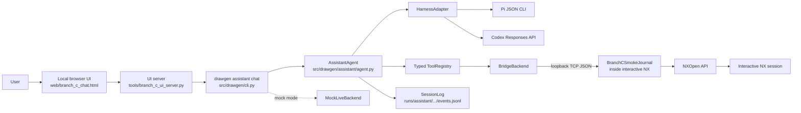
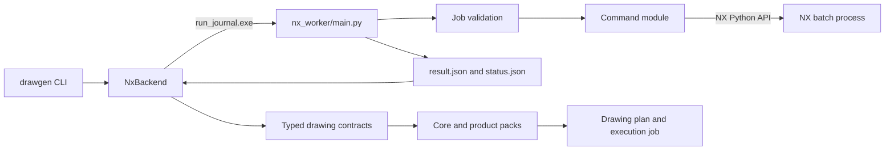
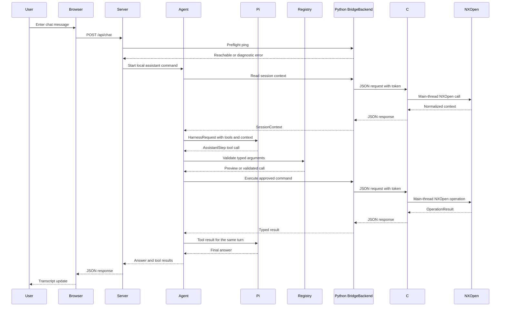

# Modeling Assistant Architecture

## Scope and status

This repository contains two related runtime paths.

| Path | Purpose | Runtime status |
|---|---|---|
| Drawing generation | Extract a model and drawing, build a plan, create a native NX drawing, and export deliverables | The contracts, worker boundary, synthetic fixtures, and early worker commands exist. The full P1 to P5 drawing pipeline remains planned. |
| Branch C assistant | Accept chat input beside interactive NX, inspect the live session, and run typed operations | The local browser UI, Pi and Codex harness adapters, typed assistant tools, Python bridge client, C# NXOpen bridge, and box-with-through-hole MVP exist. Seat-level interactive loading is still required before a live test. |

The architecture keeps Python independent of NXOpen. Only the `nx_bridge` C# project and the legacy `nx_worker` journal boundary may interact with NX APIs.

## System view



The browser and the assistant process are local. The model selects from the tool specifications supplied in the assistant request. It never receives an NX object directly and it never supplies executable NXOpen code.

## Drawing-generation path

The drawing path is separate from the interactive chat path.



### Blocks

| Block | Location | Function |
|---|---|---|
| Command line | `src/drawgen/cli.py` | Selects the batch backend, live bridge backend, harness, endpoint, and confirmation mode. |
| NX batch backend | `src/drawgen/backends/nx.py` | Starts NX's `run_journal.exe`, passes a JSON job, applies a timeout, and reads the worker result. |
| Batch worker | `nx_worker/main.py` | Validates the job protocol, imports one command lazily, writes atomic status, and removes stale result files after failure. |
| Worker commands | `nx_worker/commands/` | Implement journal operations such as `ping` and `selftest`. Extraction, execution, measurement, and export are reserved for later drawing phases. |
| Contracts | `src/drawgen/contracts/` and `schemas/` | Define stable JSON models for raw models, raw drawings, plans, execution jobs, reports, findings, exports, and worker status. |
| Shared utilities | `shared/drawgen_shared/` | Provide JSON I/O, vectors, frames, tolerances, and fingerprints without importing CAD APIs. |
| Core and packs | `src/drawgen/core/` and `src/drawgen/packs/` | Reserved for deterministic feature recognition, convention learning, planning, verification, and product-specific rules. |

The batch worker has its own NX process. It cannot see the user's interactive NX selection or work part.

## Branch C runtime blocks

### Browser UI

`web/branch_c_chat.html` provides a split local page with an NX status panel, a chat transcript, an input box, and a request button. It calls:

```text
GET  /api/health
POST /api/chat  {"message":"..."}
```

The page does not call NX directly. It displays the server response and health state.

### UI server

`tools/branch_c_ui_server.py` is a small `ThreadingHTTPServer`.

Its responsibilities are:

- serve the static page;
- report whether `ugraf.exe` is running;
- read the bridge endpoint file and perform a short `ping` preflight;
- invoke `uv run drawgen assistant chat` with `--backend bridge --harness pi`;
- pass `--yes` for the trusted local browser path when auto-confirm is enabled;
- return actionable HTTP errors when the bridge is missing or unreachable.

The server does not parse CAD language and does not contain NX logic.

### CLI and assistant agent

`src/drawgen/cli.py` creates the selected backend and harness, then starts `AssistantAgent`.

`src/drawgen/assistant/agent.py` runs a progress-driven turn loop without an
operation step cap.

1. Read live context from the backend.
2. Build a `HarnessRequest` containing conversation, context, tool specifications, and earlier tool results.
3. Ask the selected harness for one `AssistantStep`.
4. Return an answer or clarification immediately, or validate and execute each requested tool call.
5. Ask for confirmation before a changing tool unless the caller supplied `--yes`.
6. Add tool results to the conversation and repeat until the harness returns a final answer or clarification. Backend failures end the turn with an actionable error. A failed measurement is returned to the harness so it can search a different validated candidate, while a repeated failed target ends the turn without an unbounded retry loop.

The agent keeps the conversation in memory for the process lifetime. Each turn can also be recorded by `SessionLog`.

### Harness adapters

`src/drawgen/assistant/harness.py` defines the provider-neutral `HarnessAdapter` port.

| Adapter | Mechanism | Authentication and configuration |
|---|---|---|
| `FakeHarness` | Deterministic rules and scripted steps for tests | No credentials |
| `CodexApiHarness` | Local HTTP request to the OpenAI Responses API with a strict JSON schema | `OPENAI_API_KEY` or `CODEX_API_KEY`, optional `OPENAI_BASE_URL` and `DRAWGEN_CODEX_MODEL` |
| `PiAgentHarness` | Local `pi` subprocess in JSON print mode | `DRAWGEN_PI_COMMAND`, `DRAWGEN_PI_ARGS`, and `DRAWGEN_PI_SKILL` |

All adapters return one validated `AssistantStep`. That step contains exactly one of these actions.

- `tool_calls`
- `answer`
- `ask_user`

The Pi adapter loads `.pi-agent/skills/nxopen-cad/SKILL.md`. The skill explains the allowed NX operations and maps user wording to typed fields such as `width`, `depth`, `height`, `hole_diameter`, `hole_center_left`, and `hole_center_bottom`.

### Contracts

`src/drawgen/assistant/contracts.py` contains provider-neutral messages.

`src/drawgen/contracts/live.py` contains live-session contracts.

- `BridgeRequest` and `BridgeResponse` carry the transport envelope.
- `SessionContext` describes work part, displayed part, application, sheet, and view.
- `Selection` contains session-local handles and selected-object properties.
- `LiveMeasureRequest` and `LiveMeasureResult` carry typed measurements.
- `ListRequest` and `ListResult` reserve typed list queries.
- `OperationResult` reports the command, undo mark, changed state, saved state, and details.

Pydantic validation is applied before a tool reaches the bridge. The box tool also rejects a hole that is too large or whose center would put part of the hole outside the box.

### Tool registry

`src/drawgen/assistant/tools/__init__.py` is the policy boundary between model output and the live backend.

It owns:

- the fixed tool list;
- JSON schemas exposed to the harness;
- Pydantic argument validation;
- read, session, and change tool classification;
- confirmation previews for changing tools;
- conversion of backend results into `ToolExecution`.

The current registry contains context, selection, measurement, list, view, model, save, and drawing-operation entries. The active C# bridge currently implements only a subset of those entries. The registry is intentionally ahead of the bridge so later operations can be added without changing the assistant protocol.

### Python bridge client

`src/drawgen/backends/bridge.py` implements the `LiveBackend` interface for the interactive bridge.

For each call it:

1. Reads `%LOCALAPPDATA%\drawgen\bridge.json`.
2. Creates a new request ID.
3. Adds the per-session token and command inputs.
4. Opens a loopback TCP connection.
5. Sends one UTF-8 JSON line.
6. Waits for one JSON response within the timeout.
7. Validates the response and checks that the response ID matches.

The client does not replay timed-out requests. A stale endpoint or a closed NX session becomes a `LiveBackendError`, which the UI reports as a bridge-unavailable message.

### C# interactive bridge

`nx_bridge/BranchCSmokeJournal.cs` is a thin interactive loader. It loads the
socket and NXOpenUI implementation from the compiled
`nx_bridge/src/BranchCSmokeRuntime.cs` assembly because NX's journal compiler
does not provide those references.

Its responsibilities are:

- acquire `Session`, `UI`, and `UFSession` from NX;
- start a loopback listener on an ephemeral port;
- create a random per-session token when one is not supplied;
- write host, port, and token to `bridge.json`;
- accept requests on background listener threads;
- queue received request lines instead of calling NXOpen from the listener;
- use an NX UI timer to drain the queue on the NX UI thread;
- wrap dispatched work with `UI.LockAccess()` and `UI.UnlockAccess()`;
- serialize a normalized bridge response.

The current journal dispatcher supports:

| Command | Function |
|---|---|
| `ping` | Confirm the bridge is alive. |
| `get_context` | Return work part, displayed part, application, and active view. |
| `get_selection` | Return selected handles, object types, tags, and available area/volume properties. |
| `measure` | Return face, body, and body-feature surface area or volume for supported requests. |
| `create_box_with_hole` | Create a new unsaved millimetre part with a subtractive through-cylinder. |
| `highlight`, `show_entity`, `hide_entity`, `isolate_entity` | Change display state for a returned handle. |
| `fit_view` | Fit the work view. |
| `update` | Run the NX update manager with one undo mark. |
| `save` | Explicitly save the work part. |

The box operation creates a new part under `work\branch_c_chat_<timestamp>.prt`. Omitted hole-center offsets use the box center. A request with explicit offsets records those values in the operation details.

`nx_bridge/src/BridgeServer.cs` and `nx_bridge/src/NxBridgeEntry.cs` provide the compiled add-in form of the same transport and dispatcher design. The compiled dispatcher still requires seat validation for the NX 2506 main-thread callback mechanism. The interactive smoke journal is the current path used for the MVP load test.

### NXOpen boundary

NXOpen is used only inside `nx_bridge/` for Branch C and inside the Python journal boundary under `nx_worker/` for the batch drawing path.

The Python assistant never sees NXOpen objects. It sees normalized JSON and session-local handles such as `tag:12345`. Handles are valid only for the current NX session and part state.

## Branch C request data flow



## Example geometry flow

For this message:

```text
Create a 120 x 80 x 25 mm box with a 8 mm through-hole.
Put the hole center 15 mm from the left boundary and 12 mm from the bottom boundary.
```

Pi is expected to emit a typed call equivalent to:

```json
{
  "tool": "create_box_with_hole",
  "args": {
    "width": 120,
    "depth": 80,
    "height": 25,
    "hole_diameter": 8,
    "hole_center_left": 15,
    "hole_center_bottom": 12
  }
}
```

The registry validates that the diameter is smaller than both box plan dimensions and that each center offset leaves the hole inside the box. The changing-tool policy creates a preview. The browser launcher passes `--yes` for the trusted local test path, so the operation proceeds without a second terminal prompt.

The journal creates the block, creates a cylinder starting below the block, subtracts the cylinder from the block body, fits the view, and returns the new part path and normalized dimensions. The part remains unsaved until the user asks for `save`.

## Confirmation, undo, and persistence

The safety boundary is split across Python and NX.

1. Pydantic models validate tool arguments.
2. The registry classifies a call as read, session, or change.
3. Change calls return a preview until confirmed.
4. The C# operation uses an NX undo mark for supported update and display changes.
5. The bridge never saves implicitly.
6. The explicit `save` tool is the only current save path.

The browser launcher sets `DRAWGEN_UI_AUTO_CONFIRM=1` and appends `--yes`. Direct CLI and Tkinter panel use an interactive confirmation unless the caller supplies `--yes`.

## Observability and failure paths

| Signal | Location or endpoint | Meaning |
|---|---|---|
| UI health | `GET /api/health` | Reports NX process state, bridge reachability, endpoint path, Pi availability, backend, and auto-confirm state. |
| Bridge endpoint | `%LOCALAPPDATA%\drawgen\bridge.json` | Current loopback address and per-session token. It is generated runtime state and should not be committed. |
| Assistant log | `runs/assistant/<session_id>/events.jsonl` | User messages, harness requests, assistant steps, tool results, and checker decisions. |
| Batch status | Worker output directory `status.json` | Structured success or failure for a batch journal job. |
| Batch result | Worker output directory `result.json` | Present only after a successful command. |
| NX diagnostics | NX user temp `.syslog` files | Native loader, journal, and NXOpen failures. |

Typical failure flow is a short diagnostic response rather than a retry. A missing endpoint, stopped listener, invalid token, malformed JSON, ID mismatch, timeout, or NX command exception is surfaced as an assistant or UI error.

## Current operation coverage

The Python registry is broader than the current C# MVP dispatcher.

| Capability | Python registry | Current interactive C# journal | Notes |
|---|---:|---:|---|
| Context and selection | Yes | Yes | Selection fingerprints and component paths are not yet populated by the bridge. |
| Area measurement | Yes | Yes | Face, body, and body-feature surface area are supported. |
| Volume measurement | Yes | Yes | Selected bodies and body features use NX mass properties and return mm3. |
| Other measurements | Schema only | No | Length, radius, diameter, distance, and angle need bridge implementations. |
| Box with through-hole | Yes | Yes | Width, depth, height, diameter, and optional center offsets are typed. |
| Display operations | Yes | Yes | Highlight, show, hide, isolate, and fit view are available. |
| Update and save | Yes | Yes | Save is explicit. |
| Attributes and expressions | Yes | No | Registry entries exist ahead of bridge dispatch. |
| Lists | Yes | No | The live contract exists, but the current C# dispatcher does not implement it. |
| Drawing operations | Yes | No | Sheet, view, dimension, note, and export entries are reserved for later Branch C phases. |
| Drawing generation from chat | Planned | No | This is the C3 connection phase. |

## Startup and deployment sequence

The intended local startup sequence is:

1. `tools/start_branch_c_manual_test.ps1` builds the bridge and sets the repository, Pi, endpoint, NX, UI, and smoke-fixture environment variables.
2. NX starts with `ugraf.exe -nx`.
3. The UI server starts on the configured local port.
4. The browser opens the local assistant page.
5. The user loads the compiled journal or C# add-in through interactive NX.
6. The journal writes `bridge.json`.
7. The browser health panel changes to `bridge_ready: true`.
8. Chat requests can now reach the live NX session.

The bridge load is deliberately interactive because the listener must live inside the user's NX process and use that process's NXOpen session.

## Repository map

```text
src/drawgen/
  assistant/       Provider-neutral chat loop, harnesses, tools, logs, panel
  backends/        Batch backend, live backend protocol, bridge client, mocks
  contracts/       Batch and live Pydantic contracts
  cli.py           User-facing command dispatch
  core/            Reserved deterministic drawing logic
  packs/           Reserved product-specific rules

nx_bridge/
  BranchCSmokeJournal.cs  Thin interactive loader for the smoke runtime
  src/BranchCSmokeRuntime.cs  Compiled smoke runtime and loopback dispatcher
  src/BridgeServer.cs     Compiled loopback transport
  src/NxBridgeEntry.cs    Compiled NXOpen dispatcher scaffold
  NxBridge.csproj         NX2506 .NET 8 build configuration

nx_worker/
  main.py                 Batch journal protocol and status writer
  commands/               Batch command implementations
  jobs/                   Example job files

tools/
  branch_c_ui_server.py   Browser-to-CLI local server
  start_branch_c_ui.ps1   NX, server, browser, and window launcher

web/
  branch_c_chat.html      Split chat and NX status page

schemas/                  Exported JSON schemas
shared/drawgen_shared/    CAD-independent geometry and file utilities
tests/                    Architecture, contract, unit, and worker tests
```

## Known boundaries

- The live bridge is single-user, single-session, local-only, and loopback-bound.
- The C# smoke journal is the validated interactive path. The compiled add-in still needs the final NX 2506 main-thread callback confirmation.
- The current bridge implements area measurement rather than the full measurement contract.
- Drawing operations are registered in Python but are not yet dispatched by the interactive bridge.
- The batch drawing pipeline and Branch C assistant share contracts and utilities, but they do not share an NX process.
